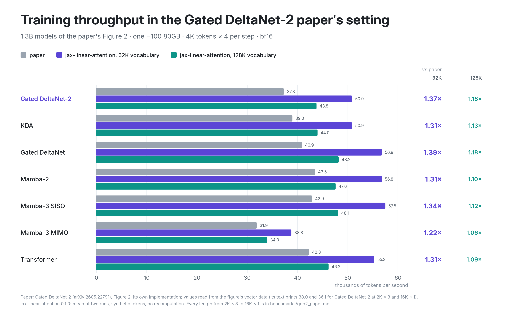

# Training throughput in the Gated DeltaNet-2 paper's setting

Figure 2 of the Gated DeltaNet-2 paper ([arXiv 2605.22791](https://arxiv.org/abs/2605.22791)) times seven
1.3B models on one H100 at a fixed 16,384 tokens per step, from 2K × 8 to 16K × 1. This page runs the same
setting with jax-linear-attention and compares it with that figure.
- The paper's text prints two of its numbers: 38.0 and 36.1 thousand tokens per second for its Gated
  DeltaNet-2 hybrid at 2K × 8 and 16K × 1.
- The figure is vector graphics, so every other value is read exactly from the PDF
  ([read_paper_fig2.py](end_to_end/gdn2_paper/read_paper_fig2.py)). That reading reproduces the two printed
  numbers.

## Setup

- One H100 80GB HBM3, JAX 0.11.2, every mixer and the attention on jax-linear-attention's Mosaic GPU
  kernels. Measured on 21 Oct 2026, one run per GPU.
- The paper's hybrid cell (its Section 3.5): recurrent mixer, MLP, sliding-window attention with a
  2,048-token window, MLP. 12 cells (24 blocks) at `d_model` 2048.
- Mixers as in the paper's Appendix E.1:
  - Gated DeltaNet, KDA and Gated DeltaNet-2: 16 heads with `d_k = d_v = 128`;
  - Mamba-2 and Mamba-3: expand 2, head dim 64, `d_state` 64;
  - Mamba-3 MIMO: rank 4.
- The paper gives no depth, MLP width or attention heads. Ours:
  - attention with 32 query heads of 64 and 8 KV heads;
  - a SwiGLU width chosen per model, so every model has 1.30B parameters (± 0.6%) with a 32,000-token
    vocabulary.
- The baseline transformer has 24 blocks of global attention with the same heads.
- **Vocabulary.** The paper does not state its tokenizer. Two rows:
  - 32,000: the Llama-2 vocabulary of the Gated DeltaNet recipe the paper's training follows;
  - 128,256: Llama-3, the vocabulary of our 1.3B presets, with an LM head four times larger.
- **Training step:** bf16 compute with fp32 master weights and AdamW state; the full AdamW update; no
  activation recomputation.
- **Data:** synthetic uniform token ids, without document masking.
- **Timing:** steps 11-30 of 30 by the wall clock; tokens per second = 16,384 / the mean step time. Each
  value is the mean of two runs.

## Results

<picture>
  <source media="(prefers-color-scheme: dark)" srcset="../docs/assets/gdn2-paper-dark.png">
  
</picture>

Thousands of tokens per second on one H100. "Paper" is the paper's Figure 2, with the two values its text
prints in bold. "Ours" is jax-linear-attention with each vocabulary. Parameters are given for the 32,000-token
vocabulary.

| model | | 2K × 8 | 4K × 4 | 8K × 2 | 16K × 1 |
|---|---|---|---|---|---|
| Gated DeltaNet-2 hybrid (1.295B) | paper | **38.0** | 37.3 | 36.9 | **36.1** |
| | ours, 32,000 | 52.1 | 50.9 | 50.8 | 49.1 |
| | ours, 128,256 | 43.2 | 43.8 | 43.4 | 42.5 |
| KDA hybrid (1.302B) | paper | 39.8 | 39.0 | 38.9 | 38.5 |
| | ours, 32,000 | 52.6 | 50.9 | 50.6 | 49.8 |
| | ours, 128,256 | 43.0 | 44.0 | 43.4 | 43.1 |
| Gated DeltaNet hybrid (1.302B) | paper | 41.9 | 40.9 | 40.0 | 39.5 |
| | ours, 32,000 | 57.9 | 56.8 | 56.3 | 55.5 |
| | ours, 128,256 | 49.4 | 48.2 | 45.6 | 46.2 |
| Mamba-2 hybrid (1.300B) | paper | 44.4 | 43.5 | 43.3 | 43.3 |
| | ours, 32,000 | 58.6 | 56.8 | 55.4 | 55.3 |
| | ours, 128,256 | 49.7 | 47.6 | 47.8 | 47.0 |
| Mamba-3 SISO hybrid (1.303B) | paper | 44.3 | 42.9 | 42.3 | 40.7 |
| | ours, 32,000 | 59.0 | 57.5 | 56.2 | 54.7 |
| | ours, 128,256 | 49.4 | 48.1 | 47.4 | 46.7 |
| Mamba-3 MIMO hybrid, rank 4 (1.295B) | paper | 34.4 | 31.9 | 29.4 | 26.9 |
| | ours, 32,000 | 39.4 | 38.8 | 38.5 | 37.3 |
| | ours, 128,256 | 33.9 | 34.0 | 33.7 | 32.9 |
| Transformer (1.308B) | paper | 45.8 | 42.3 | 36.7 | 29.4 |
| | ours, 32,000 | 60.0 | 55.3 | 46.5 | 35.8 |
| | ours, 128,256 | 50.0 | 46.2 | 40.5 | 31.5 |

- **Against the paper, with the 32,000-token vocabulary,** every model of the figure trains 1.14-1.41x
  faster at every length:

  | model | ours / paper |
  |---|---|
  | Gated DeltaNet | 1.38-1.41x |
  | Gated DeltaNet-2 | 1.36-1.38x |
  | Mamba-3 SISO | 1.33-1.34x |
  | KDA | 1.29-1.32x |
  | Mamba-2 | 1.28-1.32x |
  | Transformer | 1.22-1.31x |
  | Mamba-3 MIMO | 1.14-1.39x |

  With the four times larger Llama-3 vocabulary, the same models run 0.99-1.23x the paper's numbers. The one
  value below 1 is Mamba-3 MIMO at 2K × 8 (0.99x).
- **The Gated DeltaNet-2 hybrid's MFU** is 39.8-40.9% with 32,000 tokens and 39.0-40.2% with 128,256.
- **The same shape across lengths as the paper:**
  - From 2K × 8 to 16K × 1, Gated DeltaNet-2 loses 6% and stays within 1.5% of KDA at every length.
  - The transformer falls 40%. From 8K × 2 every hybrid except Mamba-3 MIMO passes it, and Mamba-3 MIMO
    passes it at 16K × 1.

## Where we lose, and limits

- **The Mamba-3 MIMO hybrid is the slowest hybrid, as in the paper.** With 32,000 tokens its step runs at
  31-32% MFU in 70 GiB, against 40-47% and 49-62 GiB for the other hybrids. With 128,256 tokens it is 0.99x
  the paper's number at 2K × 8, and its step peaks at 74 GiB: one of three runs at 8K × 2 ran out of memory
  at step 12, and the table gives the two that finished.
  - **Where the time goes.** Its layer expands q and k to 64 heads × 4 ranks, adds the biases and applies
    the rotation in XLA fusions around the recurrence kernels.
  - **Next.** The Mamba-3 SISO path does this work inside fused Mosaic GPU kernels. Fusing it for MIMO the
    same way is planned for the next release.
- **Not a kernel-for-kernel comparison.** Different frameworks, kernels and harnesses produced the paper's
  numbers and ours, and the paper does not give its tokenizer, depth, MLP width, attention heads or the
  data of these runs. The table shows how fast jax-linear-attention trains these models.
- **The paper's values are read from its figure.** The values are exact for the plotted points. The text
  prints only the Gated DeltaNet-2 pair.
- **Clean-room implementation.** jax-linear-attention's Gated DeltaNet-2 is implemented from the paper's
  equations; the paper's code was not run.
- **The 128,256-token rows are conservative by about 1-5%.** Those runs use the CUDA async allocator, because
  XLA's default allocator cannot place the step's buffers next to the larger embedding and LM head. It stalls
  on occasional steps, and the mean includes them.
- **Run-to-run spread:** 0-2.2% with 32,000 tokens and up to 7.7% with 128,256 tokens.

## Reproduce

From the repository root, one GPU per command. Each call runs all four splits and writes one JSON per run:

```sh
OUT=results/gdn2_paper CUDA_VISIBLE_DEVICES=0 bash benchmarks/end_to_end/gdn2_paper/run.sh gdn2-hybrid 32000
OUT=results/gdn2_paper CUDA_VISIBLE_DEVICES=1 bash benchmarks/end_to_end/gdn2_paper/run.sh gdn2-hybrid 128256
```

The other models are `kda-hybrid`, `gdn-hybrid`, `mamba2-hybrid`, `mamba3-hybrid`, `mamba3-mimo-hybrid` and
`transformer`. The TOMLs in
[end_to_end/gdn2_paper/](end_to_end/gdn2_paper/) define the models; `run.sh` documents the allocator
settings.

The paper's values, read from the arXiv PDF:

```sh
pip install pymupdf
curl -L -o gdn2.pdf https://arxiv.org/pdf/2605.22791
python benchmarks/end_to_end/gdn2_paper/read_paper_fig2.py gdn2.pdf
```
